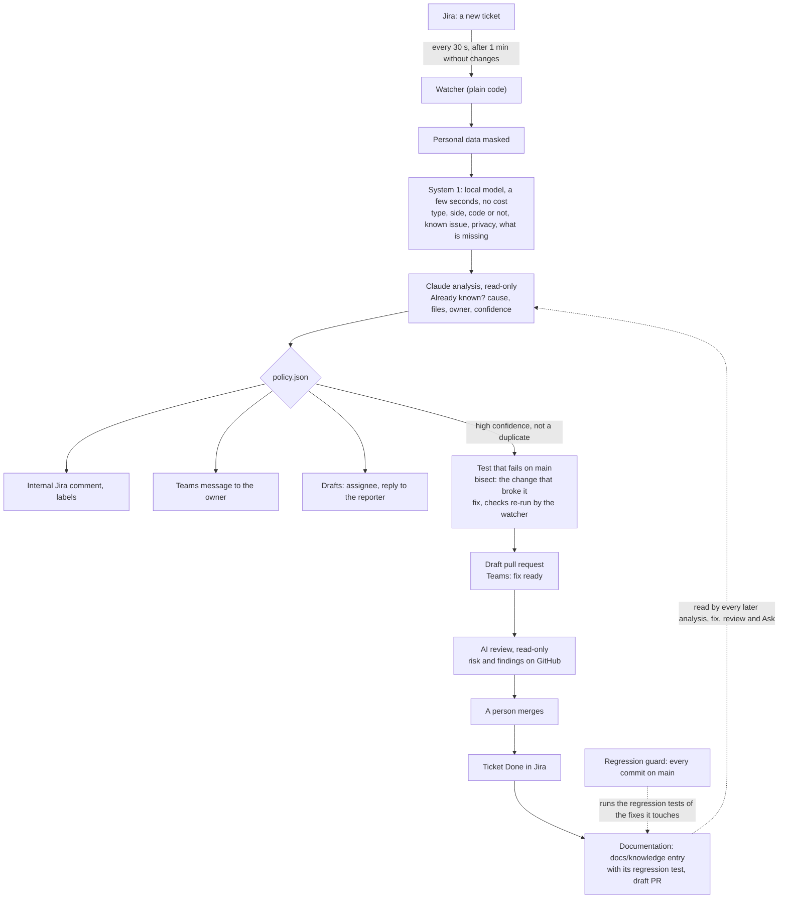

# How it works: the flow and the workflows

Status: 2026-11-16. One page for anyone who wants the whole picture before the details. The details are in [agent/README.md](../agent/README.md) (the agent), [README.md](../README.md) (the two skills) and [SPEC.md](../SPEC.md) (the requirements).

## 1. In one paragraph

Ticket Intelligence watches the Jira projects of a suite of apps. For every new ticket it finds the cause in the code and who should handle it, and tells that person in Teams. When it can, it writes a test that shows the bug, finds the change that broke it, fixes it and opens a draft pull request with the evidence. When the ticket is done, it writes what was learnt into the app's knowledge base, which every later analysis reads. Plain code collects the facts and acts; a model reads and judges. A person merges, sends and assigns.

## 2. The flow

## 3. Step by step

| # | Step | Who | What happens | Writes |
|---|---|---|---|---|
| 1 | Pick | plain code | Jira is checked every 30 s. A ticket is taken once it has not changed for a minute. Labels in Jira are the state: `ai-analyzing`, `ai-analyzed`, `ai-failed`; `no-ai` keeps the agent away. With rejected credentials the agent pauses and says why | labels |
| 2 | Mask | plain code | fiscal codes, IBANs, health cards, e-mails, phones, birth dates and the names of people outside the team are masked before any model reads the ticket | — |
| 3 | System 1 | local model (`ft-5`) | twelve questions with probabilities, on this machine. A known issue in other words runs its regression test on main (live). In shadow: the light path for tickets not about code, the queue order, the privacy hold, the question to the reporter for a half-written report | — |
| 4 | Analysis | Claude (Sonnet), read-only | the skill's script collects the ticket, related tickets, git or SVN history and the knowledge base. Claude answers **Already known?** (duplicate, in progress, fixed on main, regression, solved before, documented), then the cause, the files, the component, the owner and why, the confidence. The result must be valid JSON | — |
| 5 | Act | watcher, by `policy.json` | internal Jira comment and labels (auto); a Teams message to the owner (a real person, at least medium confidence; @mention optional); the assignee and the reply to the reporter as drafts; update emails (off until SMTP is set) | Jira, Teams |
| 6 | Reproduce and fix | Claude in its own worktree | only at high confidence and not a duplicate. A Playwright or JUnit test that must fail on main; bisect finds the commit that broke it; the fix may not touch tests; the watcher re-runs every check itself; push and a **draft** PR; evidence in Jira; a second Teams message "fix ready" | branch, draft PR, Jira |
| 7 | AI review | Claude, read-only | root cause or symptom, scope, whether the test covers the bug, regressions in shared code. A GitHub COMMENT review with risk and inline findings; it never approves or merges | GitHub comment |
| 8 | Merge | **a person** | preview the fix in the app, read the review, merge. The agent never merges | — |
| 9 | Document | Claude, writes only `docs/knowledge` | when the ticket is Done (also bugs fixed without the agent): symptom, cause (confirmed or assumed), fix, prevention, people who know it, and the regression test. Lint-checked, draft PR, merged from the dashboard | branch, draft PR, Jira |

## 4. What runs without a ticket

| What | When | Does |
|---|---|---|
| Regression guard (A1) | every commit on a watched main, within 2 minutes | blames the changed lines; when they belong to an earlier fix, runs that fix's regression test, in its version from **before** the commit (a test "adjusted" to pass CI is caught). Alerts on the commit (GitHub) and in Jira |
| Jira health | every poll | pauses the agent while Jira does not answer or rejects the token |
| Snapshots | once a day | accuracy and Insights numbers, for the trend |

## 5. What people use on the dashboard

| Tab | What |
|---|---|
| Tickets | every ticket live: System 1's answers, the analysis, the Teams message, drafts to send, the test, the PR, the review; **Run again**, **Preview in app** |
| Insights | where bugs come from (hotspots, heatmap, the change that brought each bug in), risk files, recurring problems, code copied between apps and fixes missing in a copy, knowledge map and bus factor; an AI review of the app; suggested tickets, each checked against existing ones before **Create in Jira** (a draft) |
| Ask | a question about the code, the bugs or the history, answered from checked sources in 20–30 s, or "not in the knowledge base". "Who knows X?" is answered by System 1 and plain code in about a second, without Claude. 👎 and unanswered questions become knowledge gaps |
| Graph | how often the agent was right (no answer key: what it said compared with what happened), and the ticket lanes: one lane per ticket from analysis to merge, with links to Jira and to the Teams messages |
| Impact | the management week: what the agent did, cost, hours saved against the team's baseline, what waits for a person, System 1's calibration |
| Tour, Present | a narrated walk-through (15–17 min) from recorded runs; it starts no paid run |

## 6. Workflows covered

| Workflow | State |
|---|---|
| Triage and analysis of every new ticket | done |
| Duplicates and known problems ("Already known?") | done |
| Reproduce, bisect, fix, draft PR | done (git and GitHub) |
| AI review of the pull request | done |
| Documentation on Done, backfill, refresh, lint | done |
| Regression tests of the known issues (KB1) | done |
| Regression guard on main (A1) | done |
| Accuracy from production (AI1) and replay on history (AI1b) | done |
| Insights, app review, suggested tickets | done |
| Ask over one app and the suite | done |
| Teams: owner message with an @mention and why this person, then "fix ready" with the PR | done, seen on real pilot tickets (VAX-21, VAX-17); the team's own channel needs its webhook |
| A live demo on the pilot: reserved cases, `demo/preflight.mjs --teams` ([DEMO_SCENARIO.md](DEMO_SCENARIO.md) section 9) | ready; one rehearsal to go |
| Restart without losing work (`--replace` waits for the running job), a watcher that keeps answering while it works | done |
| Merge check: every open fix PR checked again on the main of now when main moves, the result on the PR | done (2026-11-17) |
| One more try for a fix that stopped on an accident (time limit, a locked file, the network) | done (2026-11-17) |
| Impact (WF5) and ticket lanes (G1, G1b) | done |
| System 1: known issue (J4), Ask router (J5), queue order (J3) | live |
| System 1: question to the reporter (J7, WF1), light path (J2), privacy (J6) | in shadow: they say what they would do (J6 missed a name on an unseen pilot ticket, so it stays there) |
| Update emails | built, off until SMTP is configured |
| Teams as the front door (approve a fix from Teams, WF2) | deferred: needs a Teams app and IT |
| Night shift and morning digest (WF3) | deferred |
| Reply to the reporter on merge, release notes (WF4) | later |
| Blast radius (A3), branch care (A4), porting fixes to copies (A5), agent contracts and trust ladder (AG1–AG3), gaps researcher (KG1, KG2) | later ([AUTONOMY_AND_NEXT.md](AUTONOMY_AND_NEXT.md#5-recommended-order)) |

## 7. Where it runs: git, SVN and GitHub Copilot

The two skills (`/analyze-ticket`, `/document-ticket`) are what a developer runs by hand, in Claude Code or GitHub Copilot. The autonomous agent (watcher, System 1, dashboard) runs the Claude Code CLI headless; it does not run inside Copilot.

| Part | git | SVN | GitHub Copilot |
|---|---|---|---|
| `/analyze-ticket` | yes | yes: tested on the demo working copy (2026-11-09, re-checked 2026-11-16: same components and people as on git) | same `SKILL.md`, read from `~/.claude/skills` or `.github/skills`; **not run in Copilot yet** ([COPILOT_TEST.md](COPILOT_TEST.md)) |
| `/document-ticket` | review branch + PR, or direct | `patch` tested; `direct` and `branch` write to the server and are not tested yet | as above |
| Watcher: analysis, Jira comment, Teams, drafts | yes | built for it (the analysis goes through the skill's SVN adapter), not yet run on a watched SVN project | no |
| Ticket lanes and accuracy | yes | yes, from the commits (SVN has no pull requests) | no |
| Automatic fix, draft PR, AI review | yes (GitHub) | no; an SVN patch is planned (FR-39) | no |
| Bisect, regression guard, KB1 tests, knowledge refresh, documentation on Done by the watcher, Insights, replay | yes | no, git only | no |
| System 1 | yes | the questions about the text work; the known-issue question reads the knowledge base from git | no |

## 8. Guardrails

- **The model cannot write.** Headless runs return JSON only, without MCP servers or publishing tools. The watcher is the only writer, and only what `policy.json` allows.
- **Autonomy levels.**

  | Level | Meaning | Actions |
  |---|---|---|
  | L3 | acts, a person approves the result | fix PRs, documentation PRs |
  | L2 | acts and reports | Jira comment, labels, Teams message, AI review, documentation on Done |
  | L1 | prepares, a person sends | reply to the reporter, assignee, a new ticket |
  | L0 | never | change priority or status, merge |

- **Patient data.** Masked before every model; System 1 runs on this machine and sends nothing out.
- **Everything is logged** in `state/events.jsonl`, with each run's transcript.

## 9. Measured so far

| What | Result |
|---|---|
| Analysis | $0.39 and 63 s on average (49 analyses) |
| Replay on the 45 resolved bugs people fixed | a file of the real fix named 45/45, component 45/45, owner 37/45 |
| Automatic fixes | 72 % of the attempts end in a verified draft PR; 5 of 6 decided PRs merged unchanged |
| Ask | 23/24 on the eval questions |
| Regression guard | the planted VAX-13 regression alerted 2 minutes after the push; 135 commits of history: 2 alerts, both deliberate behaviour changes |
| System 1 (`ft-5`, rows it never saw) | what is wrong 96 %, where 92 %, privacy 100 %; no ticket about code on the light path |

The demo bugs are easier than real ones (most fixes change one file, and the ticket names the screen), so expect lower numbers on a real project.
