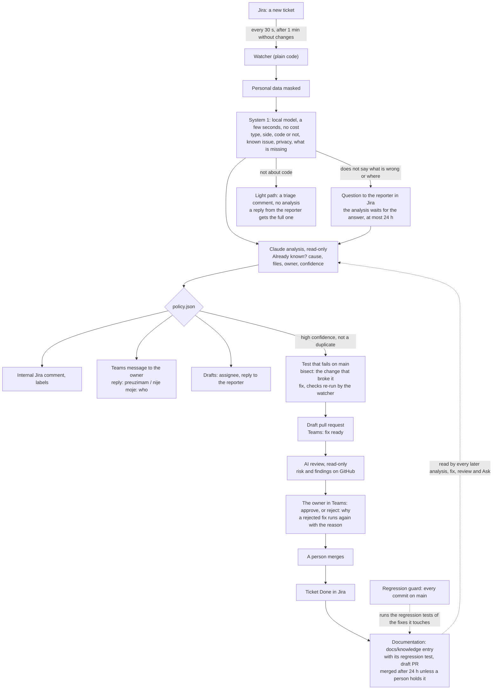

# How it works: the flow and the workflows

Status: 2026-11-18. One page for anyone who wants the whole picture before the details. The details are in [agent/README.md](../agent/README.md) (the agent), [README.md](../README.md) (the two skills) and [SPEC.md](../SPEC.md) (the requirements).

## 1. In one paragraph

Ticket Intelligence watches the Jira projects of a suite of apps. A small local model reads every new ticket first, in a few seconds: a report that does not say what is wrong or where gets a question to the reporter, and a ticket that is not about code gets a short triage instead of an analysis. Every other ticket gets a Claude analysis: the cause in the code and who should handle it, and that person is told in Teams. When it can, it writes a test that shows the bug, finds the change that broke it, fixes it and opens a draft pull request with the evidence. When the ticket is done, it writes what was learnt into the app's knowledge base, which every later analysis reads. The team asks it questions and decides on its fixes in the same Teams channel; at night it runs the checks and the backlog, and in the morning it says what it did. Plain code collects the facts and acts; a model reads and judges. A person merges, sends and decides.

## 2. The flow

## 3. Step by step

| # | Step | Who | What happens | Writes |
|---|---|---|---|---|
| 1 | Pick | plain code | Jira is checked every 30 s. A ticket is taken once it has not changed for a minute. Labels in Jira are the state: `ai-analyzing`, `ai-analyzed`, `ai-failed`, `ai-held`, `ai-triaged`; `no-ai` keeps the agent away. With rejected credentials the agent pauses and says why | labels |
| 2 | Mask | plain code | fiscal codes, IBANs, health cards, e-mails, phones, birth dates and the names of people outside the team are masked before any model reads the ticket | — |
| 3 | System 1 | local model (`ft-5`) | twelve questions with probabilities, on this machine. **Acting:** a known issue in other words runs its regression test on main; tickets waiting together are ordered by urgency; a report about code (or an unclear one) that does not say what is wrong or where gets a question in Jira, from a template in its language, and the analysis starts on the answer (or after 24 h); a ticket not about code takes the light path: a triage comment and no Claude analysis, a reply from the reporter within 14 days gets the full one, and a light path that turns out to be about code puts the light path back in shadow by itself. **In shadow** (they say what they would do): the privacy hold and the fix warm-up by the side | Jira: the question, the triage comment |
| 4 | Analysis | Claude (Sonnet), read-only | the skill's script collects the ticket, related tickets, git or SVN history and the knowledge base. Claude answers **Already known?** (duplicate, in progress, fixed on main, regression, solved before, documented), then the cause, the files, the component, the owner and why, the confidence. The result must be valid JSON | — |
| 5 | Act | watcher, by `policy.json` | internal Jira comment and labels (auto); a Teams message to the owner (a real person, at least medium confidence, @mentioned, with why them); the owner may reply **preuzimam** (assigned in Jira) or **nije moje: <who>** (handed on in the thread); the assignee and the reply to the reporter as drafts; update emails (off until SMTP is set) | Jira, Teams |
| 6 | Reproduce and fix | Claude in its own worktree | only at high confidence and not a duplicate. A Playwright or JUnit test that must fail on main; bisect finds the commit that broke it; the fix may not touch tests; the watcher re-runs every check itself; push and a **draft** PR; evidence in Jira; a second Teams message "fix ready". A fix that stopped on an accident (time limit, a locked file, the network) gets one more try | branch, draft PR, Jira |
| 7 | AI review | Claude, read-only | root cause or symptom, scope, whether the test covers the bug, regressions in shared code. A GitHub COMMENT review with risk and inline findings; it never approves or merges | GitHub comment |
| 8 | Approve and merge | **a person** | the owner (or a team lead) replies **approve** under the "fix ready" card, and the PR becomes ready for review; or **reject: why**, and the fix runs again with the reason (at most twice). While the PR is open, every move of main is checked again by a merge check. A person previews the fix in the app, reads the review and merges. The agent never merges | GitHub, Jira |
| 9 | Document | Claude, writes only `docs/knowledge` | when the ticket is Done (also bugs fixed without the agent): symptom, cause (confirmed or assumed), fix, prevention, people who know it, and the regression test. Lint-checked, draft PR. The agent merges it 24 h after it is opened, unless a review asks for changes or a person sets the label `hold`; a PR that conflicts with one merged before is merged entry by entry first | branch, PR, Jira |

## 4. What runs without a ticket

| What | When | Does |
|---|---|---|
| Regression guard (A1) | every commit on a watched main, within 2 minutes | blames the changed lines; when they belong to an earlier fix, runs that fix's regression test, in its version from **before** the commit (a test "adjusted" to pass CI is caught). Alerts on the commit (GitHub) and in Jira |
| Merge check | when a watched main moves | every open fix PR merged with the new main in a throwaway worktree, every test run on the result; the outcome on the PR |
| Teams inbox | every 5–15 s | reads the team's channel: `ti:` questions answered in the thread, decisions and "preuzimam" carried out |
| Documentation merge | every 10 minutes, when idle | documentation PRs open for 24 h, with no hold and no "changes requested", are merged |
| Researcher (KG2) | when idle, at most 3 a day | a question Ask could not answer gets a deeper read-only run; a checked answer becomes an FAQ entry in a documentation PR, otherwise the gap is marked real |
| Night shift (WF3) | once a night, 20:00–07:00, when idle | every known issue's regression test on main and the knowledge lint; then the backlog (open tickets the agent never saw), at most 10 tickets and $5 a night |
| Morning digest | working days at 08:00 | one card in the Teams channel: what was done since the last one, what came back, what waits for a person, the cost |
| Jira health | every poll | pauses the agent while Jira does not answer or rejects the token |
| Snapshots | once a day | accuracy and Insights numbers, for the trend |

## 5. What people use

| Where | What |
|---|---|
| Teams channel | the owner's two cards (the handoff, then "fix ready"); `ti: <question>` answered in the thread; `approve` / `reject: why` under a "fix ready" card; `preuzimam` / `nije moje: <who>` under a handoff card; the morning digest |
| Dashboard: Tickets | every ticket live: System 1's answers, the analysis, the Teams message, drafts to send, the test, the PR, the review; a ticket held for the reporter's answer or on the light path says why; **Run again**, **Analyze now**, **Preview in app** |
| Dashboard: Insights | where bugs come from (hotspots, heatmap, the change that brought each bug in), risk files, recurring problems, code copied between apps and fixes missing in a copy, knowledge map and bus factor, knowledge gaps with **Research**; an AI review of the app; suggested tickets, each checked against existing ones before **Create in Jira** (a draft) |
| Dashboard: Ask | a question about the code, the bugs or the history, answered from checked sources in 20–30 s, or "not in the knowledge base". Without Claude, in about a second: a ticket key gives its status and what waits for whom (from the agent's records); "who knows X", "where is the code of X", "the latest tickets", "the bugs of X" (in English, Italian or Serbian) come from plain code; the address of a page or an API path is traced to its component, API calls and controller method with its line; the same question again is given its earlier answer when main has not changed. Follow-up questions continue the conversation. Under each answer: **Send to Teams** (for a person, @mentioned), **Create a ticket** (checked against what exists), and after 👍 **Save as FAQ** (a documentation PR). 👎 and unanswered questions become knowledge gaps. The same Ask answers `ti:` questions in Teams |
| Dashboard: Graph | how often the agent was right (no answer key: what it said compared with what happened), and the ticket lanes: one lane per ticket from analysis to merge, with links to Jira and to the Teams messages |
| Dashboard: Impact | the management week: what the agent did, cost, hours saved against the team's baseline, what waits for a person, System 1's calibration, and Ask: questions, the share answered without an AI run, how often answers were rated right, cost per Claude answer |
| Dashboard: Tour, Present | a narrated walk-through (15–17 min) from recorded runs, and the presentation; they start no paid run |

## 6. Workflows covered

| Workflow | State |
|---|---|
| Triage and analysis of every new ticket | done |
| Duplicates and known problems ("Already known?") | done |
| Reproduce, bisect, fix, draft PR | done (git and GitHub) |
| AI review of the pull request | done |
| Documentation on Done, backfill, refresh, lint | done; since 2026-11-17 PRs merge in any order (K22) and the agent merges them after 24 h unless a person holds them |
| Regression tests of the known issues (KB1) | done; every night since 2026-11-18 |
| Regression guard on main (A1) | done |
| Accuracy from production (AI1) and replay on history (AI1b) | done |
| Insights, app review, suggested tickets | done |
| Ask over one app and the suite | done; grown 2026-11-17 (status, plain-code answers in three languages, page → code, follow-ups, Teams / ticket / FAQ from an answer, earlier questions, the same question given again, rating on Impact) |
| Teams: owner message with an @mention and why this person, then "fix ready" with the PR | done, seen on real pilot tickets (VAX-21, VAX-17, VAX-23, VAX-25); the team's own channel needs its webhook |
| Teams as the front door (WF2, ROADMAP #9) | **Ask in the channel live since 2026-11-17** ("ti: VAX-21" answered in the thread in 1.7 s, a Claude follow-up in 25 s). Approve / reject a fix and the owner's "preuzimam" / "nije moje" by a reply are built; their first live round is pending. The agent reads the channel through Microsoft Graph as one signed-in account, outbound only. A Teams bot with real buttons stays the production path (it needs an Azure app and IT) |
| Night shift and morning digest (WF3) | **done 2026-11-18**: the first digest was posted that morning; the first night runs 2026-11-18/19 |
| Researcher closes knowledge gaps (KG2) | done 2026-11-17: two live runs, both real gaps (no answer in the code either) |
| A live demo on the pilot: reserved cases, `demo/preflight.mjs --teams` ([DEMO_SCENARIO.md](DEMO_SCENARIO.md) section 9) | ready; one rehearsal to go. Preflight on 2026-11-18: GO but for the two pilot lines, which are set on the morning of the demo |
| Restart without losing work (`--replace` waits for the running job), a watcher that keeps answering while it works | done |
| Merge check: every open fix PR checked again on the main of now when main moves, the result on the PR | done (2026-11-17) |
| One more try for a fix that stopped on an accident | done (2026-11-17) |
| Impact (WF5) and ticket lanes (G1, G1b) | done |
| System 1: known issue (J4), Ask router (J5), queue order (J3) | live |
| System 1: question to the reporter (J7, WF1) and light path (J2) | **live since 2026-11-17**, each with a safety net: the question waits at most 24 h, the light path is undone by a reply and goes back to shadow by itself when it turns out wrong (BIL-28 asked, BIL-27 on the light path) |
| System 1: privacy hold (J6), fix warm-up by the side (J10) | in shadow: they say what they would do (J6 missed a name on an unseen pilot ticket, so it stays there) |
| Update emails | built, off until SMTP is configured |
| Reply to the reporter on merge, release notes (WF4) | later |
| Blast radius (A3), branch care beyond the merge check (A4), porting fixes to copies (A5), agent contracts and trust ladder (AG1–AG3), gaps from every signal (KG1) | later ([AUTONOMY_AND_NEXT.md](AUTONOMY_AND_NEXT.md#5-recommended-order)) |

## 7. Where it runs: git, SVN and GitHub Copilot

The two skills (`/analyze-ticket`, `/document-ticket`) are what a developer runs by hand, in Claude Code or GitHub Copilot. The autonomous agent (watcher, System 1, dashboard) runs the Claude Code CLI headless; it does not run inside Copilot.

| Part | git | SVN | GitHub Copilot |
|---|---|---|---|
| `/analyze-ticket` | yes | yes: tested on the demo working copy (2026-11-09, re-checked 2026-11-16: same components and people as on git) | same `SKILL.md`, read from `~/.claude/skills` or `.github/skills`; **not run in Copilot yet** ([COPILOT_TEST.md](COPILOT_TEST.md)) |
| `/document-ticket` | review branch + PR, or direct | `patch` tested; `direct` and `branch` write to the server and are not tested yet | as above |
| Watcher: analysis, Jira comment, Teams, drafts | yes | built for it (the analysis goes through the skill's SVN adapter), not yet run on a watched SVN project | no |
| Ticket lanes and accuracy | yes | yes, from the commits (SVN has no pull requests) | no |
| Automatic fix, draft PR, AI review, approval from Teams | yes (GitHub) | no; an SVN patch is planned (FR-39) | no |
| Bisect, regression guard, KB1 tests, knowledge refresh, documentation on Done by the watcher, Insights, replay | yes | no, git only | no |
| System 1 | yes | the questions about the text work; the known-issue question reads the knowledge base from git | no |

## 8. Guardrails

- **The model cannot write.** Headless runs return JSON only, without MCP servers or publishing tools. The watcher is the only writer, and only what `policy.json` allows.
- **Autonomy levels.**

  | Level | Meaning | Actions |
  |---|---|---|
  | L3 | acts, a person approves the result | fix PRs (approved in Teams or GitHub, merged by a person) |
  | L2 | acts and reports | Jira comment, labels, Teams messages, AI review, documentation on Done and its merge after 24 h, the question to the reporter, the light path, Ask answers in Teams, the researcher's FAQ entries, the night shift and the morning digest |
  | L1 | prepares, a person sends or decides | reply to the reporter, assignee, a new ticket (from Insights or an Ask answer), an Ask answer sent to Teams, an FAQ from a 👍; approve / reject and "preuzimam" / "nije moje" are a person's reply that the agent carries out |
  | L0 | never | change priority or status, merge a fix |

- **Every step it takes alone has a way back.** The question to the reporter waits at most 24 h; the light path is undone by the reporter's reply, and one that turns out to be about code puts the light path back in shadow; a documentation PR is stopped by the label `hold` or a review; the night stops at its cost limit; `no-ai` on a ticket keeps the agent away.
- **Patient data.** Masked before every model; System 1 runs on this machine and sends nothing out. What goes to Teams is masked too.
- **Everything is logged** in `state/events.jsonl`, with each run's transcript.

## 9. Measured so far

| What | Result |
|---|---|
| Analysis | $0.32 and 56 s on average (84 analyses in the event logs, 2026-11-18) |
| Pilot with an answer key (MediVax) | 7 of 7 bugs: the files, the breaking commit, the owner, a verified fix PR and an exact bisect, every one right; the one regression alerted before its ticket, no false alarm; $14.79 for the seven |
| Replay on the 45 resolved bugs people fixed | a file of the real fix named 45/45, component 45/45, owner 37/45 |
| Automatic fixes | 28 draft PRs and 10 stopped attempts: 74 % end in a verified draft PR; 5 of 6 decided PRs merged unchanged (2026-11-13) |
| Ask | 23/24 on the eval questions; on the suite (2026-11-17): 79 questions, 67 % answered without an AI run, 94 % found, $0.22 and about 21 s per Claude answer |
| Regression guard | the planted VAX-13 regression alerted 3.4 minutes after the push, 17 hours before its ticket; 135 commits of history: 2 alerts, both deliberate behaviour changes |
| System 1 (`ft-5`, rows it never saw) | what is wrong 96 %, where 92 %, privacy 100 %; no ticket about code on the light path. Live: BIL-28 asked 4 s after it was queued, BIL-27 on the light path in 1 s |
| Masking on the pilot | 16 of 20 quoted patient identifiers; the misses are uncommon first names, there on purpose |
| Tests | 307 automated tests of the agent, all passing (2026-11-18) |

The demo bugs are easier than real ones (most fixes change one file, and the ticket names the screen), so expect lower numbers on a real project.
